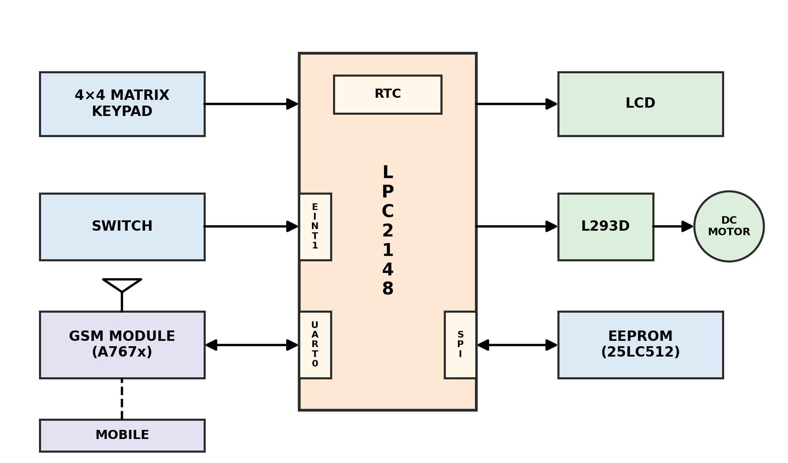
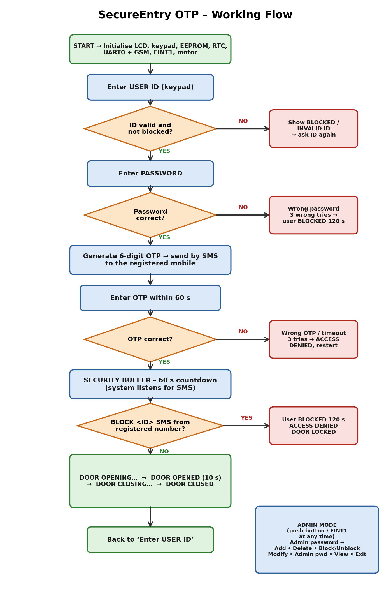

# SecureEntry OTP
### GSM-Based Two-Step, Time-Limited Door Access System

SecureEntry OTP is an LPC2148-based smart door lock. A user enters a **User ID and password**, receives a **one-time password (OTP) by SMS** on a registered mobile number, and the door opens only after the OTP is verified. During a **60-second security buffer**, the owner can **block the entry with a single SMS**.

| | |
|---|---|
| **Developed by** | Ashwini |
| **Platform** | LPC2148 (ARM7TDMI-S) |
| **Language / Tools** | Embedded C, Keil µVision, Flash Magic |
| **Domain** | Embedded Systems • Access Control • GSM Communication |

---

## Table of Contents
1. [Objective](#1-objective)
2. [Problem Statement and Motivation](#2-problem-statement-and-motivation)
3. [Key Features](#3-key-features)
4. [System Architecture](#4-system-architecture)
5. [Hardware Requirements and Pin Configuration](#5-hardware-requirements-and-pin-configuration)
6. [Software Requirements](#6-software-requirements)
7. [System Operation](#7-system-operation)
8. [Administrator Mode](#8-administrator-mode)
9. [System Parameters](#9-system-parameters)
10. [Default Configuration](#10-default-configuration)
11. [Firmware Structure](#11-firmware-structure)
12. [Build and Deployment](#12-build-and-deployment)
13. [Testing and Verification](#13-testing-and-verification)
14. [Troubleshooting](#14-troubleshooting)
15. [Limitations and Future Enhancements](#15-limitations-and-future-enhancements)
16. [Conclusion](#16-conclusion)

---

## 1. Objective

To develop an LPC2148-based door access system that identifies users through a unique User ID, sends a time-limited OTP to the corresponding registered mobile number, and grants access only after successful OTP verification. The system also enables registered users to remotely **block** and **unblock** access through SMS commands.

## 2. Problem Statement and Motivation

Password-only door locks are vulnerable: a password can be guessed, observed or shared, and the owner is never informed when someone tries to use it.

SecureEntry OTP addresses this with **two-factor authentication** (password + OTP on the owner's phone) and an **owner-controlled remote override**. Every access attempt generates an SMS alert, and a single reply can stop an unauthorised entry.

## 3. Key Features

- Two-step authentication: User ID and password, followed by an SMS OTP
- OTP valid for 60 seconds, with a limit of 3 attempts
- 60-second security buffer with a live countdown on the LCD
- Remote **BLOCK / UNBLOCK** by SMS, accepted only from the registered mobile number
- Automatic temporary lock-out after 3 wrong passwords
- Non-volatile storage of users, passwords, mobile numbers and admin password in SPI EEPROM
- Administrator mode (interrupt driven) to add, delete, modify, block, unblock and view users
- Door control with clear status messages: *Opening → Opened → Closing → Closed*
- Interrupt-driven UART reception for reliable GSM communication

---

## 4. System Architecture



The LPC2148 reads the keypad and the admin push button, communicates with the GSM module over UART0, stores user data in the SPI EEPROM, shows status on the LCD, and drives the door motor through an L293D driver. The on-chip RTC provides the time stamp used in the OTP message and the block timers.

## 5. Hardware Requirements and Pin Configuration

| Component | Purpose |
|---|---|
| LPC2148 development board | Main controller |
| SIMCom A767x GSM module with active SIM | Sends OTP, receives BLOCK / UNBLOCK SMS |
| 16×2 character LCD | User interface and status messages |
| 4×4 matrix keypad | Entry of ID, password, OTP and admin options |
| 25LC512 SPI EEPROM (3.3 V) | Permanent data storage |
| L293D motor driver with DC motor | Door actuator |
| Push button | Admin mode interrupt (EINT1) |

| Module | LPC2148 pins |
|---|---|
| LCD data D0–D7 | P0.8 – P0.15 |
| LCD RS / RW / EN | P0.16 / P0.17 / P0.18 |
| Keypad rows | P1.16 – P1.19 |
| Keypad columns | P1.20 – P1.23 |
| GSM module (UART0) | P0.0 (TXD0) → modem RX, P0.1 (RXD0) ← modem TX |
| EEPROM (SPI0) | P0.4 SCK, P0.5 MISO, P0.6 MOSI, P0.7 CS |
| Admin push button | P0.3 (EINT1, falling edge) |
| L293D inputs | P0.20 (IN1), P0.21 (IN2) |

**Wiring notes**
- All grounds (board, GSM module, motor driver, EEPROM) must be common.
- EEPROM `WP` and `HOLD` pins connect to 3.3 V.
- L293D `1,2 EN` connects to 5 V; power the GSM module from a supply that can deliver burst current.
- P0.0 / P0.1 are also the programming UART. Disconnect the GSM TX/RX wires while flashing.

## 6. Software Requirements

- Keil µVision (ARM) with the LPC2148 device support
- Flash Magic (programming through the UART bootloader)
- Embedded C

---

## 7. System Operation



1. **User ID entry.** The system verifies that the ID exists (otherwise `USER NOT FOUND`) and is not blocked (otherwise `USER BLOCKED`).
2. **Password verification.** The entered password is compared with the value stored in EEPROM. After 3 wrong attempts the user is blocked for 120 seconds.
3. **OTP generation.** A 6-digit OTP is generated and sent, with the user ID and time, to the registered mobile number.
4. **OTP verification.** The OTP must be entered within 60 seconds. Three wrong entries or a time-out deny access and restart the process from User ID entry.
5. **Security buffer (60 s).** The LCD shows a countdown while the system listens for SMS:
   - `BLOCK <UserID>` from the registered number → the user is blocked, access is denied and the door remains locked.
   - `UNBLOCK <UserID>` from the registered number → the block is removed.
6. **Door sequence.** If no block is received, the door operates as follows:

   | Motor action | LCD message |
   |---|---|
   | Rotating to open | `DOOR OPENING...` |
   | Stopped, door open (about 10 s) | `DOOR OPENED` |
   | Rotating in reverse | `DOOR CLOSING...` |
   | Stopped, door closed | `DOOR CLOSED` |

**Sample OTP message**

```
SecureEntry: OTP:123456 FOR USER ID:1234 TIME:30-10-2026 15:45
VALID:60SEC. IF NOT YOU, REPLY BLOCK 1234 / UNBLOCK 1234.
Please Do Not Share OTP with Anyone
```

> BLOCK and UNBLOCK commands must be sent as **plain SMS** (not RCS / chat messages), in capital letters, exactly in the form `BLOCK 1234`.

## 8. Administrator Mode

Pressing the push button (external interrupt on P0.3) requests administrator access. After the admin password is verified, the following menu is available. Use `#` for the next screen and `*` for the previous screen.

| Screen | Option | Function |
|---|---|---|
| 1 | **1 – Add** | Register a user: 4-digit ID, password (confirmed), 10-digit mobile number (maximum 4 users) |
| 1 | **2 – Delete** | Remove a user after confirmation |
| 2 | **3 – Block / Unblock** | Manually block or unblock a user |
| 3 | **4 – Modify** | After password verification, change the user's ID, password or mobile number |
| 3 | **5 – Admin password** | Change the administrator password (stored in EEPROM) |
| 4 | **6 – View** | List registered users and the total count |
| 4 | **7 – Exit** | Return to User ID entry |

**Keypad functions:** `D` Enter • `B` Backspace • `C` Clear • `*` Previous • `#` Next

## 9. System Parameters

| Parameter | Value |
|---|---|
| Maximum users | 4 |
| User ID / password length | 4 digits |
| OTP length | 6 digits |
| OTP validity | 60 seconds |
| OTP attempts | 3 |
| Password attempts before lock-out | 3 |
| Lock-out duration | 120 seconds |
| Security buffer | 60 seconds |
| Door motor run time (open / close) | 2 seconds each |
| Door open hold time | 10 seconds |
| GSM UART baud rate | 9600 |

Constants are defined in `user.c` (user limit, attempts, lock-out), `otp.c` (OTP validity) and `door.c` (door timing).

## 10. Default Configuration

| | User ID | Password |
|---|---|---|
| User 1 | 1234 | 1111 |
| User 2 | 5678 | 2222 |
| Administrator | – | 0000 |

Registered mobile numbers are defined in `user.c`:

```c
#define mobile_1   "XXXXXXXXXX"   // User 1: 10 digits, without +91
#define mobile_2   "XXXXXXXXXX"   // User 2
```

The defaults are written to the EEPROM only once. To store new numbers, change `MOBILE_INIT_MARKER` in `user.c` to a different value, then rebuild and flash. Alternatively, change a number from the admin menu (Modify → option 3).

---

## 11. Firmware Structure

| File | Role |
|---|---|
| `main.c` | Peripheral initialisation and main loop (login / admin mode) |
| `user.c`, `user.h` | Login flow, OTP flow, security buffer, user database, admin menu |
| `gsm.c`, `gsm.h` | AT command handling, SMS send, SMS receive and command parsing |
| `uart.c`, `uart.h`, `uart_defines.h` | UART0 driver with receive interrupt and ring buffer |
| `otp.c`, `otp.h` | OTP generation, verification and expiry timing |
| `rtc.c`, `rtc.h` | On-chip RTC setup, read and write |
| `eint.c`, `eint.h`, `switch.c`, `switch.h` | External interrupt for admin mode |
| `spi.c`, `spi.h`, `spi_defines.h` | SPI0 master driver |
| `spi_eeprom.c`, `spi_eeprom.h`, `spi_eeprom_defines.h` | 25LC512 byte read / write |
| `lcd.c`, `lcd.h`, `lcd_defines.h` | 16×2 LCD driver |
| `Keypad.c`, `kpm.h`, `kpm_defines.h` | 4×4 keypad scan with debounce |
| `door.c`, `door.h` | Motor control and door sequence |
| `door_cgram.c`, `door_cgram.h` | Custom LCD characters and door status messages |
| `main_dly.c`, `delay.h` | Millisecond and second delays |
| `defines.h`, `types.h` | Bit-manipulation macros and data types |

**Peripherals and concepts used:** GPIO, UART with interrupts, external interrupt (EINT1), SPI, on-chip RTC, vectored interrupt controller (VIC), AT commands, non-volatile data storage.

## 12. Build and Deployment

1. Create a Keil µVision project for the LPC2148 and add all `.c` files to the source group.
2. In `main.c`, make sure `GSM_Init();` is enabled and set the current date and time (`SetRTCTimeInfo`, `SetRTCDateInfo`).
3. In `user.c`, enter the registered mobile numbers.
4. Build the project. It must complete with **0 errors**.
5. Program the generated `.hex` file with Flash Magic and reset the board.
6. Insert an active SIM in the GSM module. The start-up screens should end with `SMS RX READY`.

---

## 13. Testing and Verification

| # | Test case | Expected result |
|---|---|---|
| 1 | Valid ID, correct password, correct OTP, no BLOCK | Door opens, holds, then closes with all four status messages |
| 2 | Unknown User ID | `USER NOT FOUND`; ID requested again |
| 3 | Wrong password 3 times | `USER BLOCKED`, `WAIT: 02:00` (120 seconds) |
| 4 | No password entered in time | `PASSWORD TIMEOUT`, `LOGIN AGAIN` |
| 5 | Wrong OTP | `WRONG OTP` with attempts left; after 3 attempts access is denied |
| 6 | `BLOCK <ID>` from the registered number during the security buffer | `BLOCK RECEIVED`; `ACCESS DENIED`, `DOOR LOCKED` |
| 7 | `UNBLOCK <ID>` from the registered number | `UNBLOCK RECEIVED`; block removed |
| 8 | `BLOCK <ID>` from an unregistered number | Message ignored |
| 9 | Admin button, correct admin password | Admin menu displayed |
| 10 | Add a user, power-cycle the board | User still present (EEPROM storage) |

## 14. Troubleshooting

| Symptom | Possible cause and remedy |
|---|---|
| LCD blank | Adjust the contrast pot; check D0–D7 on P0.8–P0.15 and RS / RW / EN on P0.16 / P0.17 / P0.18; in `lcd_defines.h` set `LCD_RW` to 17 and `LCD_EN` to 18 |
| OTP SMS not received | Check SIM balance and network; confirm all start-up messages passed; verify the stored mobile number |
| BLOCK has no effect | Send as plain SMS (not RCS); use capitals; the ID must be the logged-in user's ID; send from the registered number; ensure `GSM_Init()` is enabled |
| Old mobile number appears | Change `MOBILE_INIT_MARKER` in `user.c`, rebuild and flash |
| Wrong date or time in SMS | Set the correct values in `main.c` before flashing |
| Motor runs in the wrong direction | Swap the two motor wires at the L293D outputs |
| Board does not program | Disconnect the GSM TX/RX wires from P0.0 / P0.1 during flashing |

## 15. Limitations and Future Enhancements

**Current limitations**
- The OTP is derived from the clock; a hardware random source would be stronger.
- The RTC retains time across power-off only if a backup battery is fitted to VBAT.
- Passwords are stored as plain numbers in EEPROM; hashing would improve security.
- BLOCK commands are processed during the 60-second security buffer.
- Supports 4 users.

**Possible enhancements**
- Confirmation SMS replies for BLOCK and UNBLOCK
- Door position sensor and buzzer alert on repeated failures
- Larger user database and per-user access logs
- Hardware random number source for OTP generation

## 16. Conclusion

SecureEntry OTP demonstrates how embedded peripherals (UART, SPI, RTC, external interrupt, keypad and LCD) can be combined with GSM communication to build a practical, layered access-control system in which the owner stays informed and in control of every entry attempt.
